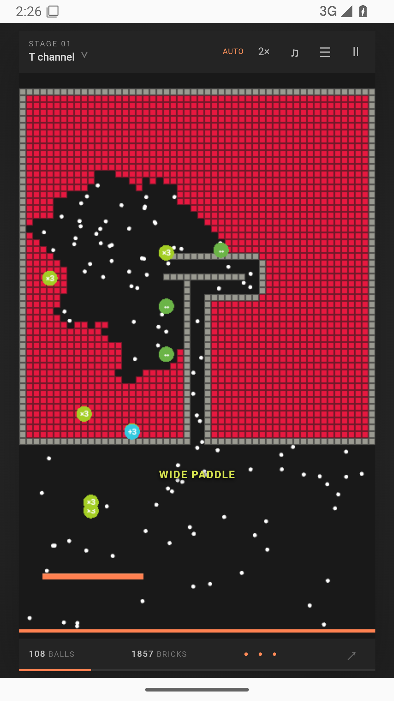
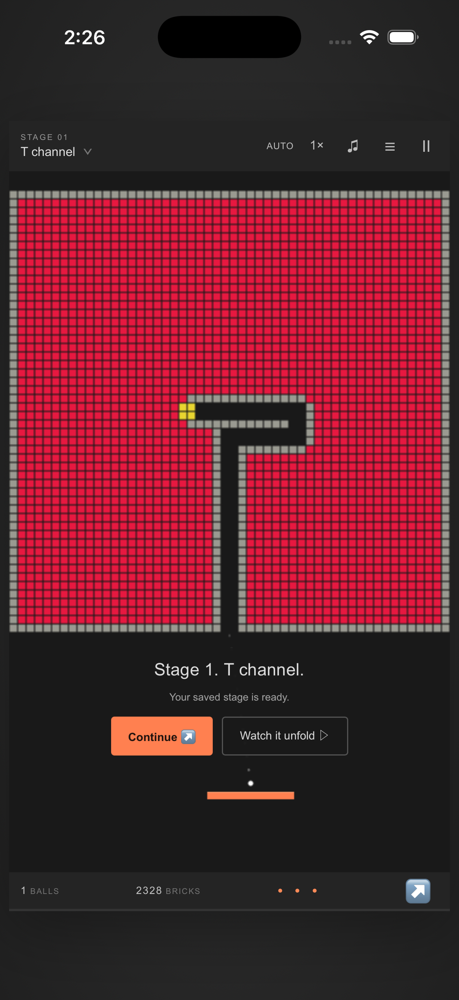

# Brick Breaker · Channels & Swarms

A reconstruction of the dense-grid brick breaker shown in the reviewed X videos: permanent gray channel walls, a plain orange paddle, solid colored fields, breakable exit caps, +3 pickups, and ×3 ball multiplication that grows a swarm into hundreds of white balls.

Requested source repository: https://github.com/SpeedInno-Org/Brick-Breaker

Public browser version: https://speedinno.github.io/brick-breaker/

Public source and native build mirror: https://github.com/speedinno/brick-breaker

Android test APK and iOS build downloads: https://github.com/speedinno/brick-breaker/releases/tag/v2.0.0

## What changed in v2

The earlier Prism Rush interpretation was replaced. This version uses a dense 52 × 52 field; twelve reference-style T / H / M / W / sword / needle / bent / nested / heart / stepped motifs; indestructible gray maze walls; and earned, falling multiplication pickups. There is no automatic opening fireball, random missing-brick noise, bomb grid, Pulse button, or large marketing layout.

The first twelve stages reproduce the observed motifs. Later stages generate connected variations. A pattern chooser makes each motif directly playable. Additional small gate tiles ensure enclosed colored regions can be cleared, which is necessary for progressing beyond the clips' unfinished fields. This is newly written code that recreates visible behavior, not the original game's source, branding, or a claim of pixel-identical physics.

## Play

Move the mouse or drag anywhere on the board to steer the paddle. Launch through the entrance and catch falling boosts: **+3** adds three balls; **×3** triples the current swarm, up to a bounded 768 balls; **↔** widens the paddle; **—** adds a temporary safety floor; **♨** enables temporary fireballs. Gray walls remain even for fireballs.

**Watch it unfold / AUTO** controls only the paddle using the same simulation. Watch starts at 2× speed. The speed control cycles through 1×, 2×, and 4×. Keyboard: arrows / A / D move, Space launches or advances, P / Escape pauses. App switching pauses automatically. Stages and local best scores save on this device.

## Android and iPhone

The game is bundled into native Capacitor Android and iOS projects and runs without a hosted-site connection. Native apps do not use the web service worker. There are no ad SDKs, accounts, payments, or runtime analytics.

- **Android:** the native CI builds an installable, debug-signed APK and an unsigned release AAB. A debug APK is suitable for direct testing; a release intended for Google Play needs the owner's production signing configuration and store setup.
- **iPhone:** native CI builds an unsigned device archive and an iPhone Simulator app. The archive must be signed with the owner's Apple Developer team before a physical iPhone/TestFlight/App Store installation. The simulator build is not an installable iPhone IPA.
- **Browser installation:** Android browser menu → Install app; iPhone Safari → Share → Add to Home Screen. Offline play begins after the first successful web cache installation. This is available separately from the native packages.

See [mobile build instructions](docs/MOBILE.md), [reference review](docs/REFERENCES.md), and [red-team/QA report](docs/RED_TEAM.md).

Actual Android app running in an API 35 emulator with network access disabled:



Actual iPhone Simulator app after process relaunch, showing the saved-stage prompt:



## Develop and build

Node.js 22+:

```sh
npm ci
npm run dev
npm test
npm run check
npm run mobile:sync
```

Local preview: http://127.0.0.1:4173. `dist/` is the complete static game and supports subdirectory deployment. The development-only `/__mobile?width=390&height=844` route previews a narrow viewport.

Android: open `android/` in Android Studio, or use `npm run android:open`; Java 21 and Android SDK 36 are needed for command-line builds. iOS: use a Mac with Xcode 26+, open `ios/App/App.xcodeproj`, choose your signing team and target, and build. `npm run ios:open` opens it on a Mac.

`.github/workflows/mobile.yml` builds both native platforms. `.github/workflows/test.yml` runs game checks. `publish-pages.mjs` publishes the static `dist/` subtree to the existing public `github` mirror without exposing organization repository settings or changing the organization's private audience.

Original game code is MIT licensed. Bundled font files retained from v1 include their SIL Open Font Licenses, though the v2 game uses system fonts. No reference video images, third-party watermarks, or app-store branding are bundled.
