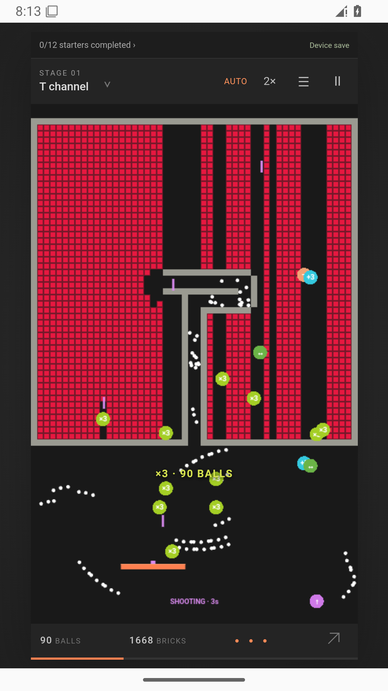
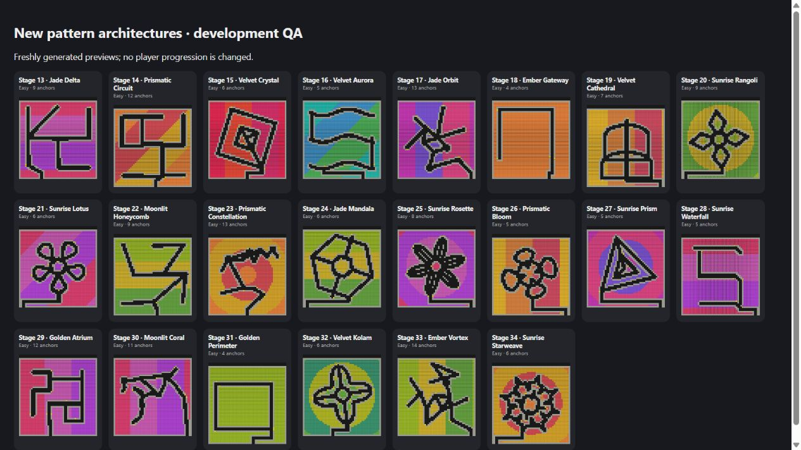

# Brick Breaker · Channels & Swarms

**Current candidate: 3.3.0/build23 on `codex/easier-opening-rounds`.** Start with the [product implementation report and complete acceptance coverage](docs/PRODUCT-COMPLETION-2026-10.md), [ordered account setup guide](docs/ACCOUNT-SETUP-2026-10.md), [mobile build history](docs/MOBILE-BUILD-3.3.md), and [starter difficulty rollout](docs/STARTER-DIFFICULTY-ROLLOUT.md). Provider activation, physical-player acceptance, Apple signing and store approvals remain pending. [FINAL-HANDOFF.md](FINAL-HANDOFF.md) retains the earlier release history.

Dense colored fields, permanent gray channels, an orange paddle and earned +3/×3 and piercing paddle-shooting pickups that grow one white ball into a swarm. Mobile-first web, Android and iPhone source. Version 3 adds a clear stage journey and optional cloud integration.

**Older web demo (3.0, not this candidate):** https://speedinno.github.io/brick-breaker/

**Primary private source:** https://github.com/SpeedInno-Org/Brick-Breaker

**Approved public source/build mirror:** https://github.com/speedinno/brick-breaker

**Previous Android test APK:** [3.3.0 build 22 download](https://github.com/speedinno/brick-breaker/releases/download/v3.3.0-rc.2/Brick-Breaker-3.3.0-build22-Android-test.apk). Build 23 is the new wider-opening candidate; obtain its exact package from the [public releases](https://github.com/speedinno/brick-breaker/releases) after native checks pass. Signed-in starter play needs the v5 database/API rollout described in the account guide.

**Mobile history:** [3.1.0 presentation](docs/MOBILE-PRESENTATION-3.1.md) and [3.2.0 phone-feedback fixes](docs/MOBILE-FEEDBACK-3.2.md). This branch preserves the populated cloud configuration and existing player progress. Earlier guides describe dated releases; use the current report before provisioning replacements or treating historical native tests as candidate acceptance.

**Mobile API on Azure:** [Azure CLI deployment](docs/AZURE-API.md) runs in SpeedInno Org Subscription, with Supabase Auth/Postgres and Resend SMTP. The current API, database migrations, dedicated reward ingress and scheduled recovery worker are deployed; hosted API checks and automatic maintenance execution passed. Commercial accounts/callbacks remain unverified. Deployment uses ACR builds without GitHub Actions.

## The journey

Clear the twelve starter stages in any order. Each clear earns **✓ Completed**. All twelve unlock stage 13; later stages unlock one at a time. Future cards show locks without previews. Tap a lock to see exactly what to finish, or use Play next. Replaying stages preserves completion and best results. AUTO and manual clears both count.

The first two starter boards have ten-tile entrances, stage 3 has eight and stage 4 has six. Stages 5–8 use four-tile entrances; stages 9–12 narrow to the original two-tile challenge. The paddle and speed ease in gradually, boosts are more frequent early, and stages 1–8 include a free paddle shooter on each launch that tapers from twelve to one second. Shorter, open motifs come first; crossing chambers arrive after the early wins. Completed-stage records remain separate from the current field snapshot.
After the starters, every eighth stage beginning with stage 20 is a Breather with a slower ball, wider paddle and more frequent boosts. Its published pattern remains stable for players who have already downloaded it.

Beyond the starters, twenty-two architecture recipes construct new chambers, loops and branching paths. These are newly synthesized layouts, not mirrored starter boards. The cloud catalog is designed to publish each versioned stage once and reuse it for everyone, with canonical structural deduplication and concurrent publication protection. An expanding journey describes the system accurately; finite grids cannot guarantee mathematically infinite unique boards.

Drag to steer, launch through the entry and catch boosts. +3 adds three balls; ×3 triples the swarm up to768; ↔ widens the paddle; — adds a temporary safety floor; ♨ enables temporary fireballs; the pink/purple shooting pickup fires piercing paddle shots for eight seconds. Gray walls remain. Optional assistance uses the same simulation and a finite shared time bank, with1×/2×/4× playback; deliberate manual input takes over. Keyboard: arrows/A/D move, Space launches/advances, P/Escape pauses. Manual and clean mastery give completed stages a replay goal.

Guest progress and the current field save on the device. Optional email accounts synchronize completed stages/history; the current swarm remains local. Guest linking preserves progress without minting assistance time. Accounts have separate local namespaces, export and deletion/recovery flows. Real adapters for two consumable time packs and voluntary rewarded ads are implemented but unconfigured/inactive by default. There are no forced ads or subscriptions. Optional account play analytics is off by default and on the live API; no guest analytics identifier or external analytics SDK is added.

## Development

Node 22+:

```sh
npm ci
npm run build:web
npm test
npm run check
npm run dev
npm run mobile:sync
```

Preview http://127.0.0.1:4173. Development-only `/__mobile?width=320&height=568` provides a compact viewport. `QA_FIXTURES=1` enables explicitly labeled disposable progression fixtures on the dev server; these routes are not shipped in `dist` or native assets.

`dist/` is the complete static app. `supabase/` contains the migration and authenticated Edge Function. `npm run configure:cloud` generates public configuration from environment variables; see the handoff. `node scripts/release-preflight.mjs --production` checks required public configuration. Do not put administrator keys in a client build.

CI runs game/database tests, generator parity and backend type checking, then creates a debug Android APK, unsigned Android AAB, unsigned iOS archive and simulator app. Signing and physical-device testing are separate. Android uses Java 21, SDK 36/min 24. iOS uses Xcode 26+, minimum 15.4. The simulator app is not an installable iPhone IPA. See [mobile builds](docs/MOBILE.md), [architecture](docs/ARCHITECTURE.md), [QA/red-team evidence](docs/RED_TEAM.md), and [reference review](docs/REFERENCES.md).

Public native artifacts/releases: https://github.com/speedinno/brick-breaker/releases

The original game code is MIT licensed; bundled dependency/font licenses apply to their files. Reference clips, third-party branding and watermarks are not bundled. Newly written behavior inspired by reviewed clips is not the original game's source or a claim of pixel-identical physics.

## Product downloads and evidence

[Version 3.1 mobile presentation and verification](docs/MOBILE-PRESENTATION-3.1.md) includes full-screen native windows, safe areas, continuous arena borders, sharper patterns and keyboard-aware account panels. Downloads are on the [public releases page](https://github.com/speedinno/brick-breaker/releases).

Historical: [version 3.0.0 packages and guide](https://github.com/speedinno/brick-breaker/releases/tag/v3.0.0) · [3.0.0 build/test evidence](docs/RELEASE-FINAL.md). Historical RC1/RC2 releases remain preserved. The screenshot below documents that earlier release; current native screenshots are linked in the 3.1 handoff.

Actual compiled Android app under offline emulator gameplay checks:





The journey grows gently in difficulty and marks progress through eight-stage chapters. Later stages weave more paths and chambers together, with carefully bounded ball speed and paddle control. Early breakthrough boosts remain. Styles are shuffled across chapters, and future patterns stay hidden until entered.

New future boards include rangoli, kolam, rosette and starweave motifs with radial colours. Artistic contours keep their symmetry without random chords. Continuous solid grey walls frame narrow channels; occasional mouths are near the far left or right edge, with a directional launch hint. Existing downloaded definitions remain stable.
